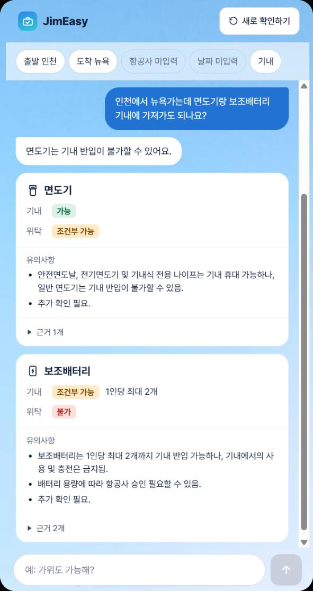
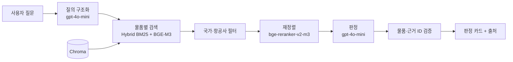
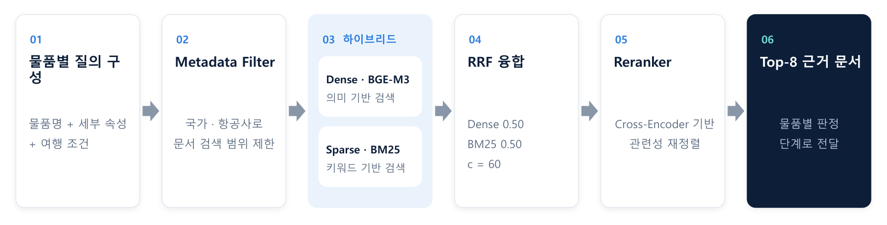

# 짐이지 (JimEasy) · 백엔드

**여행 조건과 물품을 말하면, 공식 규정을 근거로 기내·위탁 수하물 반입 여부를 알려 주는 AI 챗봇의 백엔드입니다.**
"인천에서 도쿄 가는데 보조배터리 2개 기내에 가져가도 돼?"처럼 물으면 물품마다 `가능`·`조건부 가능`·`불가`·`확인 필요`와 조건, 근거 문서를 함께 돌려줍니다.
배터리 용량이나 항공사처럼 판단을 바꾸는 정보가 빠져 있으면 먼저 되묻습니다.

<p align="center">
  
  <br><sub>실제 말뭉치로 실행한 화면(2026년 11월 발표 시점). 답변은 예시이며 공식 안내가 아닙니다.</sub>
</p>

| 레포 | 역할 |
|---|---|
| **[jimeasy-backend](https://github.com/CARRY-CHECK/jimeasy-backend)** | **질의 구조화, 규정 검색(Hybrid + 재정렬), 근거 기반 판정, 대화 API** |
| [jimeasy-frontend](https://github.com/CARRY-CHECK/jimeasy-frontend) | 채팅 화면(React + Vite), 판정 카드와 추가 질문 UI |

두 레포는 HTTP API로만 연결됩니다.

## 개요

여행자는 물품별 반입 규정을 공항·항공사·정부 사이트에서 따로 찾아 자신의 여정에 맞는 기준을 비교해야 합니다.
짐이지는 한국·일본·미국·영국·중국의 법령과 공항·항공사·정부 안내를 한곳에서 검색해 답합니다.

1. **질의 구조화**: LLM이 질문에서 여행 조건(출발·도착 장소와 항공사, 여행일, 기내/위탁)과 물품 목록(이름, 용량·수량 같은 속성)을 JSON 스키마로 뽑습니다.
2. **물품별 검색**: 물품마다 BM25와 임베딩 검색을 합친 Hybrid 검색으로 후보를 모으고, 여정의 국가·항공사에 맞는 자료만 남긴 뒤 cross-encoder로 다시 정렬해 상위 8개를 고릅니다.
3. **근거 기반 판정**: LLM이 검색 문서만 보고 기내·위탁 판정과 설명, 사용한 근거를 고릅니다. 코드는 물품과 근거 ID가 실제 입력과 맞는지 검증하고, 출처 정보는 검색 결과에서 직접 채웁니다.

## 주요 기능

| 기능 | 설명 |
|---|---|
| 자연어 물품 인식 | "면도기, 여분 옷, 목걸이"처럼 섞여 있는 목록을 물품별로 나누고 `20,000mAh 2개` 같은 속성을 함께 뽑습니다 |
| 여정에 맞는 검색 | 도시·공항 별칭으로 국가를 정하고, 질문한 항공사 자료만 남기면서 정부·공항 공통 규정은 유지합니다 |
| 근거가 붙는 판정 | 판정마다 근거 문서의 출처명·기관·URL·버전이 붙습니다. 근거를 고르지 못한 판정은 `확인 필요`로 낮춥니다 |
| 되묻기 | 판정에 필요한 정보가 부족하면 선택지와 함께 최대 3개를 묶어 묻고, 답을 받으면 이어서 판정합니다 |
| 대화 상태 유지 | "같은 조건으로 텀블러는?"처럼 앞의 여행 조건을 이어받고, 물품 추가·수정·조건 해제를 구분합니다 |
| 범위 밖 안내 | 지원하지 않는 국가나 해석할 수 없는 장소는 다른 나라 자료로 대신 답하지 않고 범위 밖이라고 안내합니다 |

## 아키텍처



대화 API는 이 흐름을 `structure_query` → (`request_clarification`) → `search_regulations` → `finalize_answer` 네 도구로 나눠 LLM이 순서를 고르고,
코드는 도구 인자·대화 상태·호출 횟수·근거를 검증합니다.

물품 하나의 검색은 아래 순서로 진행됩니다. 국가·항공사 필터를 건 범위에서 의미 검색(Dense)과 키워드 검색(BM25) 후보를 각각 50개씩 모아 RRF로 합치고, 상위 30개를 cross-encoder로 다시 정렬해 8개를 판정에 넘깁니다.



자세한 내용은 [docs/architecture.md](docs/architecture.md)에 있습니다.

## 평가 요약

팀이 직접 만든 65문항(108개 물품)으로 초기 버전과 현재 버전을 같은 정답·같은 평가 코드로 비교했습니다.

| 지표 | 초기 | 현재 |
|---|---:|---:|
| 질의 구조화 전체 일치율 | 43.08% | **90.77%** |
| 검색 Recall@5 | 28.21% | **48.89%** |
| 판정 Accuracy (물품 × 기내/위탁) | 38.39% | **43.58%** |
| 질문 전체 판정 일치율 | 24.62% | **32.31%** |

구조화와 검색은 크게 나아졌지만 판정 정확도는 소폭 개선에 그쳤습니다. 조건이 붙는 규정을 `가능`이나 `불가`로 단정하거나 `확인 필요`를 거의 고르지 않는 문제가 남아 있습니다.
LLM 없이 잰 검색 실험(Hybrid·필터·재정렬 비교), 지표 정의, 오류 분석은 [docs/evaluation.md](docs/evaluation.md)에 있습니다.

## 빠른 시작 (합성 샘플)

Python 3.12가 필요합니다. 처음 실행할 때 임베딩·재정렬 모델(각 약 2.3GB)을 Hugging Face에서 내려받습니다. NVIDIA GPU나 Apple Silicon이 있으면 재정렬이 빨라집니다.

```bash
git clone https://github.com/CARRY-CHECK/jimeasy-backend.git && cd jimeasy-backend
python3.12 -m venv .venv && source .venv/bin/activate    # Windows: py -3.12 -m venv .venv; .venv\Scripts\activate
pip install -r requirements.txt     # Windows + NVIDIA: requirements-windows.txt / Apple Silicon: requirements-mac.txt

# 1. API 키 없이 확인
python -m unittest discover -s tests/unit -p "test_*.py"   # 오프라인 단위 테스트
python -m scripts.store_chroma                              # 합성 샘플 29청크를 data/chroma에 적재
python -m tests.unit.smoke_service_pipeline                 # LLM 없이 검색·재정렬·대화 루프 점검(15개 항목)

# 2. OpenAI 키로 실행
cp .env.example .env                                        # OPENAI_API_KEY를 채운다
python -m scripts.ask "인천에서 도쿄 가는데 74Wh 보조배터리 2개 기내에 가져가도 돼요?" --show-parsed
python -m scripts.chat                                      # 터미널 대화
python -m uvicorn app.api.main:app --port 8000              # API 서버, 문서: http://127.0.0.1:8000/docs
```

```bash
curl -s -X POST http://127.0.0.1:8000/chat -H "Content-Type: application/json" \
  -d '{"message": "가위 날 길이가 5cm인데 기내에 들고 타도 돼요?"}'
```

> 샘플의 규정 문구는 팀이 만든 **가상 예시**입니다. 답변 내용이 실제 규정과 다를 수 있으며, 샘플은 파이프라인 동작을 확인하는 용도입니다.

Windows·Mac 설정과 자주 만나는 오류는 [docs/troubleshooting.md](docs/troubleshooting.md)를 보세요.

## 설정

| 위치 | 항목 | 뜻 |
|---|---|---|
| `.env` | `OPENAI_API_KEY` | 구조화·판정·대화 진행에 쓰는 OpenAI 키(필수, 단위 테스트에는 불필요) |
| `.env` | `CARRY_CHECK_MODEL_CONFIG` | 모델 설정 파일 선택(선택). Apple Silicon은 `config/mac_model.json` |
| `config/setting.json` | `chunk_sources`, `paths.chroma`, `chroma_collection` | 적재할 청크 파일, Chroma 위치와 컬렉션 이름 |
| `config/setting.json` | `retrieval.*`, `default_k` | 검색 방식(`hybrid`/`dense`), 방식별 후보 수(50), 재정렬 후보 수(30, 0이면 끔), 항공사 필터, 최종 문서 수(8) |
| `config/setting.json` | `*_system_prompt` | 구조화·대화 진행·문구 다듬기·판정에 쓸 `prompts/` 파일 |
| `config/model.json` | `query`, `answer`, `present`, `agent`, `embedding`, `chat` | 역할별 LLM과 파라미터, 임베딩 모델과 장치, 대화 엔진과 호출 상한 |

`.env`는 커밋하지 않습니다(`.env.example` 참고). 설정과 프롬프트를 바꾸면 다음 프로세스부터 적용되고, 잘못된 검색 설정은 시작할 때 오류로 알립니다.
`CARRY CHECK`는 개발 단계의 코드명이라 환경변수와 프롬프트에 남아 있습니다.

## 데이터

이 레포에는 법령·공항·항공사·해외 정부 자료의 원문이나 청크가 **없습니다**. 팀이 만든 합성 샘플(`data/sample/`)만 있습니다.
원래 말뭉치(5개 국가, 25개 출처, 1,690청크)의 구성, 출처별 이용 조건 검토 상태, 청크 형식, 자신의 데이터로 바꾸는 방법은 [docs/data.md](docs/data.md)에 있습니다.

## API

| 엔드포인트 | 내용 |
|---|---|
| `POST /chat` | `{session_id?, message}` 또는 직전 추가 질문의 선택지 `{session_id, choice}`. 판정 카드, 요약, 추가 질문, 진단 정보를 돌려준다 |
| `POST /chat/reset` | 세션의 조건·물품·대기 중인 질문을 지운다 |

요청·응답 필드와 오류 코드는 [docs/api.md](docs/api.md)에 있습니다.

## 프로젝트 구조

```
app/
  api/              FastAPI 앱 (/chat, /chat/reset)
  chat/             대화 서비스, 도구, 세션 상태, 조건 규칙, 응답 스키마
  integrations/     OpenAI(LangChain) 호출, 임베딩 함수
  schemas/          구조화·판정 스키마
  rag.py            단발성 흐름: 구조화 → 물품별 검색 → 판정
  search.py         검색 방식 선택, DB 점검, warmup
  retrieval.py      Dense 검색, 국가·항공사 필터와 별칭 표
  hybrid_retrieval.py  Kiwi BM25 + Dense + RRF
  rerank.py         cross-encoder 재정렬
  judgment.py       판정 프롬프트, 물품·근거 ID 검증
config/             검색·경로 설정, 모델 설정
data/sample/        합성 청크와 샘플 평가셋·대화 시나리오
docs/               아키텍처, API, 데이터 카드, 평가, 설치와 문제 해결
prompts/            구조화·판정·대화 진행·문구 프롬프트 (이전 버전 포함)
scripts/            CLI(질문, 대화, 데이터셋 실행·채점, Chroma 적재)
  evaluation/       검색·재정렬 실험과 보고서 도구
  data_preprocessing/  원래 말뭉치의 정제·청크 분할·ID 통일 코드(참고용)
tests/unit/         오프라인 단위 테스트, 서비스 점검(smoke), OpenAI 연결 점검
```

## 테스트

```bash
python -m unittest discover -s tests/unit -p "test_*.py"
```

단위 테스트는 OpenAI·Chroma·모델을 모의 객체로 바꿔 오프라인으로 돕니다. 비공개 평가셋이 필요한 테스트 1개는 파일이 없으면 건너뜁니다.
실제 모델과 DB를 쓰는 점검은 `python -m tests.unit.smoke_service_pipeline`(LLM 없음), 실제 OpenAI 호출 가능 여부는 `python -m tests.unit.check_openai`로 확인합니다.

## 한계

- 한국·일본·미국·영국·중국 다섯 나라만 지원합니다. 장소·항공사 필터는 `app/retrieval.py`의 별칭 표에 있는 이름만 인식합니다.
- 경유(환승) 구간을 표현하지 못합니다. 왕복은 하나의 종합 판정과 설명으로 답하고, 여행일은 하나만 받습니다.
- 규정의 시행일·유효 기간으로 거르지 않아 개정 전 자료가 근거로 쓰일 수 있습니다.
- 통관·검역(도착국 반입 규정)은 다루지 않습니다.
- 판정 정확도는 65문항 기준 43.58%입니다. 평가셋이 작고 단일 실행 결과라 수치는 참고용입니다.
- 대화 세션은 서버 메모리에만 있고 인증이 없습니다. 검색과 재정렬은 프로세스 안에서 한 번에 하나씩 처리합니다.

## 만든 사람들

[Chaewon-Leee](https://github.com/Chaewon-Leee)(이채원), [jiwoneight](https://github.com/jiwoneight)(정지원), [ginny0825](https://github.com/ginny0825)(김지은), [nickjjang7](https://github.com/nickjjang7)(옥석현). 자세한 명단은 [AUTHORS.md](AUTHORS.md)에 있습니다.

## 감사의 말

- 임베딩 [BAAI/bge-m3](https://huggingface.co/BAAI/bge-m3), 재정렬 [BAAI/bge-reranker-v2-m3](https://huggingface.co/BAAI/bge-reranker-v2-m3), 형태소 분석 [Kiwi](https://github.com/bab2min/kiwipiepy), 벡터 DB [Chroma](https://www.trychroma.com/), [LangChain](https://www.langchain.com/), [FastAPI](https://fastapi.tiangolo.com/)를 사용했습니다. 각 모델과 라이브러리는 자체 라이선스를 따릅니다.
- 규정 자료는 국가법령정보센터, 각국 정부·공항·항공사의 공개 안내를 참고했으며 이 레포로 재배포하지 않습니다([docs/data.md](docs/data.md)).
- 코드와 문서 일부는 AI 코딩 도우미(Anthropic Claude)의 도움을 받아 작성했습니다.

## 고지

- 학습·교육 목적의 비상업 프로젝트입니다. 문서에 언급한 항공사·공항·정부 기관과 관련이 없으며 이들의 승인이나 후원을 받지 않았습니다.
- **짐이지의 답변은 공식 안내가 아닙니다.** 수집 시점(2026년 10월)의 자료와 LLM의 판단에 기반하므로 틀리거나 오래되었을 수 있습니다. 여행 전 이용 항공사·공항·정부의 공식 안내를 확인하세요.
- 이 레포에는 제3자 자료(규정 원문, 웹 페이지, 수집 결과)가 들어 있지 않습니다.

## 라이선스

코드는 [MIT 라이선스](LICENSE)로 배포합니다. MIT 라이선스는 이 레포의 코드에만 적용되며, 외부 자료와 그 파생물에는 적용되지 않습니다.
