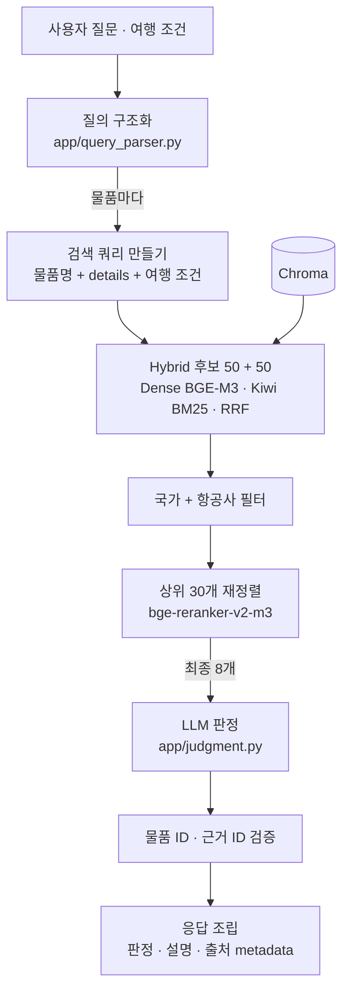
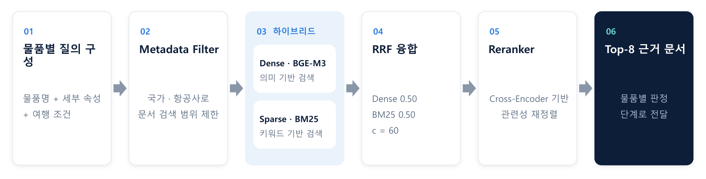
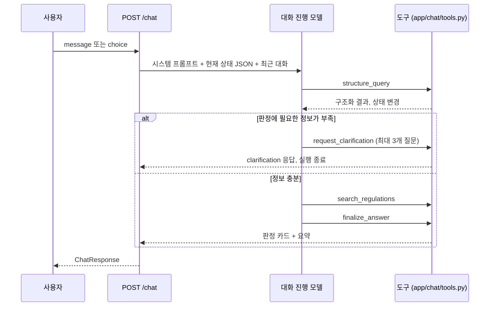

# 아키텍처

짐이지 백엔드는 **질의 구조화 → 물품별 검색 → LLM 판정 → 근거 ID 검증 → 응답 조립**의 공통 흐름을
단발성 실행(CLI·데이터셋)과 대화 API가 함께 쓴다. 대화 API는 이 흐름을 네 개의 도구로 나눠 LLM이 순서를 고르게 하고,
코드는 도구 인자·상태·호출 횟수·근거 ID를 검증한다.

## 전체 흐름

| 단계 | 코드 | 하는 일 |
|---|---|---|
| 구조화 | `app/query_parser.py`, `app/schemas/query.py` | LLM이 여행 조건(출발·도착 장소와 항공사, 여행일, 기내/위탁)과 물품 목록(이름, 용량·수량 등 details)을 strict JSON Schema로 추출한다. 출발지가 없으면 한국을 기본값으로 쓴다. CLI에서 준 조건은 추출 결과보다 우선한다 |
| 검색 | `app/rag.py` → `app/search.py` → `app/hybrid_retrieval.py`, `app/retrieval.py`, `app/rerank.py` | 물품마다 따로 검색해 최종 k개(기본 8)를 고른다 |
| 판정 | `app/judgment.py`, `prompts/system.txt`, `prompts/user_items.txt` | 물품별 검색 문서를 짧은 참조 ID(`item_1_doc_3`)와 함께 넘기고, LLM이 기내·위탁 판정, 설명, 사용한 참조 ID를 돌려준다 |
| 검증·조립 | `app/judgment.py` | 물품 ID가 누락·중복·추가 없이 일대일인지, 참조 ID가 그 물품에 실제로 준 문서인지 확인한다. 근거를 하나도 고르지 않은 판정은 `확인 필요`로 바꾼다. 물품명과 출처 metadata는 코드가 채운다 |
| 표현(대화) | `app/chat/presenter.py` | 판정은 그대로 두고, 카드 옆 짧은 조건 문구와 한 줄 요약만 LLM이 다듬는다 |

판정 값은 `가능`, `불가`, `조건부 가능`, `확인 필요` 네 가지다. 모델은 원본 청크 ID·URL·날짜를 만들지 않고 짧은 참조 ID만 고르므로,
출처가 조작되거나 다른 물품의 문서가 섞이는 것을 코드에서 막는다. 다만 ID가 유효하다는 것이 그 문서가 판정을 실제로 뒷받침한다는 뜻은 아니다.

## 검색

`config/setting.json`의 `retrieval`이 방식을 정한다. 기본값은 평가([evaluation.md](evaluation.md))로 고른 설정이다.

1. **검색 쿼리**: 물품명, details, 출발·도착 장소와 항공사, 여행일, 기내/위탁을 공백으로 이어 붙인다(`app/rag.py`의 `build_retrieval_query`).
2. **후보 범위(필터)**
   - **국가 필터**: 출발·도착 장소를 `PLACE_COUNTRIES` 별칭 표로 국가 코드로 바꿔 그 국가 문서만 남긴다. 별칭에 없거나 모호한 장소(예: 홍콩)를 부분 문자열로 추측하지 않는다. 장소를 하나도 해석하지 못하면 국가 필터 없이 검색한다.
   - **항공사 필터**: 질문의 출발·귀국 항공사가 `AIRLINE_ORGS`에 있으면, 정부·공항 등 항공사가 아닌 문서는 모두 남기고 항공사 문서는 해당 항공사 것만 남긴다. 항공사가 없거나 말뭉치에 없는 항공사면 거르지 않는다.
3. **Hybrid 후보**: 필터를 통과한 문서에서 Dense(Chroma, BGE-M3) 상위 50개와 Kiwi 형태소 BM25 상위 50개를 가중 RRF(0.5 : 0.5, c=60)로 합친다. BM25 인덱스는 같은 후보 집합이면 메모리에서 재사용한다.
4. **재정렬**: Hybrid 상위 30개(`rerank_pool`)를 cross-encoder `BAAI/bge-reranker-v2-m3`로 다시 매겨 최종 8개(`default_k`)를 판정에 넘긴다. `rerank_pool`을 0으로 두면 재정렬 없이 Hybrid 상위 k개를 쓴다.

`retrieval.method`를 `dense`로 바꾸거나 CLI에서 `--retrieval dense`를 주면 이전 방식(국가 필터, Dense 상위 k개)으로 실행한다. 과거 기준선 재현용이다.

운영 동작:

- API 서버는 시작할 때 임베딩·reranker 모델을 미리 불러오고 DB를 점검한다(`retrieval.warmup`). DB 청크 수가 청크 파일과 다르거나 필터용 metadata가 비어 있으면 로그에 오류를 남긴다.
- reranker를 불러오지 못하면 Hybrid 순서로 **조용히 대체하지 않고** 오류를 낸다.
- 후보 검색과 reranker는 프로세스 안에서 한 번에 하나씩 실행한다(BM25 캐시·Kiwi·GPU 공유). 동시 요청은 순서대로 기다린다.
- Chroma 컬렉션이 비어 있으면 첫 검색 때 `chunk_sources`의 청크를 자동으로 적재한다.

## 대화 API

`POST /chat`은 요청마다 도구 호출 루프를 한 번 돈다(`app/chat/service.py`의 `handle_tools`). 대화 진행 모델은 매 단계 반드시 도구 하나를 호출해야 하며(`tool_choice=required`, 병렬 호출 금지),
자유 텍스트로 판정을 내놓으면 무시하고 도구를 다시 요구한다.

| 도구 | 하는 일 |
|---|---|
| `structure_query` | 매 턴 첫 도구. 공통 파서로 실제 사용자 발화를 구조화하고, 물품 교체·추가·수정(`replace`/`add`/`update`/`keep`), 조건 해제, "모름" 답변을 상태에 반영한다 |
| `request_clarification` | 판정을 바꿀 정보(예: 배터리 Wh, 항공사)를 최대 3개까지 묶어 묻고 이번 요청을 끝낸다. 서버가 "잘 모르겠어요" 선택지를 붙인다 |
| `search_regulations` | 현재 상태의 물품별 검색. 상태가 바뀌지 않았으면 다시 검색하지 않는다 |
| `finalize_answer` | 현재 검색 버전의 근거로 판정·검증하고 응답을 만든 뒤 끝낸다 |

상태 관리(`app/chat/sessions.py`, `app/chat/conditions.py`):

- **조건 계승**: 첫 턴에만 출발지 한국 기본값을 채운다. 다음 턴에서 언급하지 않은 조건은 유지하고, 명시적으로 해제한 조건만 비운다. "같은 조건으로 텀블러는?"은 여행 조건만 이어받고 텀블러만 답한다.
- **물품 ID와 검색 버전**: 물품마다 세션 안에서 유지되는 ID가 있고, 물품·조건이 바뀌면 검색 버전이 올라가 이전 검색 근거로 판정하지 못한다.
- **선택지 검증**: 지난 질문이나 초기화 이전의 선택지(`choice`)는 400으로 거부한다.
- **실패 시 롤백**: 요청 처리 중 오류가 나면 세션에 부분 상태를 저장하지 않는다.
- **미지원 장소**: 지원 국가(KR·JP·US·UK·CN) 밖이거나 해석하지 못한 구간은 다른 국가 자료로 대신 답하지 않고 범위 밖이라고 안내한다.
- **한도**: 요청당 대화 진행 모델 호출 최대 8회(`chat.max_steps`), 모델에 넘기는 최근 메시지 12개(`chat.history_messages`). 실제 호출 수·토큰·시간은 `diagnostics.model_calls`에 남는다.

세션은 프로세스 메모리에만 저장된다. 영속 저장, 만료(TTL), 여러 worker 간 공유, 인증은 구현하지 않았다.
`config/model.json`의 `chat.engine`을 `legacy`로 바꾸면 도구 호출 이전의 고정 흐름으로 돌아간다(비교·롤백용).

## 설정과 프롬프트

- `config/setting.json`: 경로, Chroma 컬렉션, 검색 설정, 사용할 프롬프트 파일, 허용 필터. 잘못된 검색 설정은 시작할 때 오류로 알린다.
- `config/model.json`: 역할별 LLM(`query`, `answer`, `present`, `agent`)과 임베딩 설정. 기본은 모두 `gpt-4o-mini`, temperature 0, strict JSON Schema, 재시도 0회.
- `config/mac_model.json`: 임베딩을 MPS에서 돌리는 Apple Silicon용 설정. `CARRY_CHECK_MODEL_CONFIG`로 고른다. 지정한 파일이 없으면 다른 설정으로 대체하지 않고 멈춘다.
- `prompts/`: 실행할 때마다 파일을 다시 읽는다. 비어 있거나 없는 파일은 숨은 기본 프롬프트로 대체하지 않고 오류를 낸다. 실험 기록 재현을 위해 이전 버전 프롬프트(`*_ver1.txt` 등)도 함께 둔다.

| 프롬프트 | 용도 |
|---|---|
| `parse_system_en_ver2.txt` (기본) | 질의 구조화. 영문 지시, 출발지 한국 기본값, 평가셋과 겹치던 예시를 교체한 판 |
| `parse_system_ver1.txt`, `parse_system_ver2.txt`, `parse_system_en_ver1.txt`, `parse_system.txt`, `parse_system_en.txt` | 이전 구조화 프롬프트(실험 재현용) |
| `parse_user.txt` | 구조화 사용자 템플릿(`$question`) |
| `system.txt`, `user_items.txt` | 판정 시스템 프롬프트와 물품별 문서 템플릿(`$question`, `$conditions`, `$filters`, `$context`) |
| `chat/agent_system_ver2.txt` (기본), `chat/agent_system_ver1.txt` | 대화 진행(도구 선택) |
| `chat/present_system_ver2.txt` (기본), `chat/present_system_ver1.txt`, `chat/present_user.txt` | 카드 문구 다듬기. ver1은 `legacy` 엔진용 |
| `user.txt` | 과거 단일 검색 템플릿(현재 실행에서는 쓰지 않음) |

프롬프트와 일부 식별자에 남은 `CARRY CHECK`는 개발 단계의 코드명이다. 프롬프트 파일은 실험 기록에 해시가 남으므로 이름을 바꾸지 않았다.

## 모듈 지도

| 경로 | 내용 |
|---|---|
| `app/api/main.py` | FastAPI 앱. `POST /chat`, `POST /chat/reset`, 시작 시 warmup |
| `app/chat/` | 대화 서비스(`service.py`), 도구(`tools.py`), 세션(`sessions.py`), 조건 규칙(`conditions.py`), 스키마(`schemas.py`), 문구 다듬기(`presenter.py`) |
| `app/rag.py` | 단발성 흐름 `answer_question()`과 물품별 검색 `search_by_items()` |
| `app/search.py` | 설정에 따른 검색 방식 선택, DB 점검, warmup |
| `app/retrieval.py` | Chroma Dense 검색, 국가·항공사 필터와 별칭 표 |
| `app/hybrid_retrieval.py` | Kiwi BM25 + Dense + 가중 RRF |
| `app/rerank.py` | cross-encoder 재정렬(장치 자동 선택: CUDA → MPS → CPU) |
| `app/judgment.py` | 판정 프롬프트 조립, 물품·근거 ID 검증, 출처 연결 |
| `app/query_parser.py` | 질의 구조화와 프롬프트 파일 선택 |
| `app/integrations/` | OpenAI(LangChain) 호출과 사용량 수집, 임베딩 함수 |
| `app/schemas/` | 구조화·판정 Pydantic 스키마 |
| `app/settings.py` | 설정 파일 읽기와 검증 |
| `app/evaluate_hybrid_search.py`, `app/query_gold_similarity.py`, `app/embedding_token_stats.py` | 검색 실험·진단 도구(LLM 호출 없음) |
| `scripts/` | CLI 진입점(질문, 대화, 데이터셋 실행·평가, Chroma 적재), 평가 도구(`evaluation/`), 전처리(`data_preprocessing/`) |
| `tests/unit/` | 오프라인 단위 테스트와 실행 점검(`smoke_service_pipeline`, `check_openai`) |
