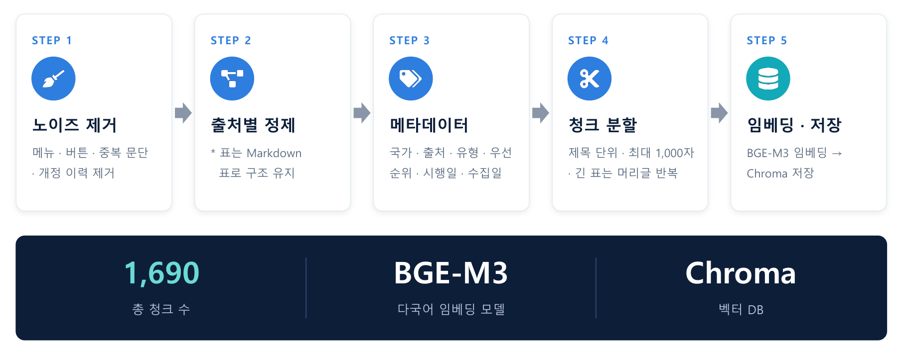

# 데이터 카드

이 레포에는 **코드와 작은 합성 샘플만** 있다. 실제 서비스 말뭉치를 만들 때 수집한 법령·공항·항공사·해외 정부 자료의
원문, 전처리 결과, 청크, 임베딩 DB, 평가셋과 실행 기록은 들어 있지 않으며 이 레포를 통해 재배포하지 않는다.

> **MIT 라이선스는 이 레포의 코드에만 적용된다.** 아래 제3자 자료에 대한 어떤 권리도 주지 않는다.
> 자료를 받거나 가공하거나 그 결과를 공개하기 전에 각 출처의 이용 조건을 직접 확인한다.

## 레포에 들어 있는 것

| 경로 | 내용 |
|---|---|
| `data/sample/chunks.jsonl` | 가상 출처 9개 문서, 29개 청크. 팀이 직접 쓴 짧은 예시 문구이며 실제 규정이 아니다 |
| `data/sample/questions.json`, `queries.json` | 위 샘플에 맞춘 5문항의 최종 답변 정답과 질의 구조화 정답 |
| `data/sample/chat_scenarios.json` | 대화 흐름 점검용 시나리오 3개(질문 문장만 있음) |
| `prompts/` | 질의 구조화·판정·대화 진행·문장 다듬기 프롬프트(팀 작성) |
| `app/retrieval.py`의 `PLACE_COUNTRIES`, `AIRLINE_ORGS` | 장소·항공사 이름을 국가 코드와 말뭉치의 기관명으로 바꾸는 별칭 표 |

`data/` 아래는 `data/sample/`을 빼고 모두 Git에서 제외된다. 샘플의 자세한 설명은 [data/sample/README.md](../data/sample/README.md)에 있다.

## 원래 말뭉치 (레포에 없음)

서비스와 평가에 쓴 말뭉치는 5개 국가, 25개 출처, **148개 문서, 1,690개 청크**였다(2026-10-29 기준, 2026년 10월 수집).
아래 표는 출처를 밝히기 위한 것이며 해당 자료는 레포에 없다.

| 국가 | 유형 | 출처 | 문서 / 청크 | 이용 조건 (검토 상태) |
|---|---|---|---:|---|
| KR | 법령 | 국토교통부 소관 법령(항공안전법, 항공보안법 및 하위 법령), 국가법령정보센터 | 12 / 154 | 법령·고시는 저작권법 제7조의 보호받지 않는 저작물. 수집은 국가법령정보 공동활용 Open API(인증키) 이용 조건을 따른다 |
| KR | 행정규칙 | 국토교통부 고시(항공기 내 반입금지 위해물품, 항공위험물운송기술기준 등), 국가법령정보센터 | 12 / 409 | 위와 같음 |
| KR | 보도자료 | 국토교통부(대한민국 정책브리핑) | 5 / 11 | 공공누리 유형 **검토하지 않음** |
| KR | 공항 | 인천국제공항공사 제한물품 안내 | 1 / 7 | **검토하지 않음** |
| KR | 항공사 | 대한항공, 아시아나항공, 진에어, 트리니티항공(구 티웨이항공) 수하물 안내 | 5 / 84 | 각 사 이용약관 **검토하지 않음** |
| JP | 정부 | 일본 국토교통성(MLIT) | 3 / 106 | **검토하지 않음** |
| JP | 관광 안내 | 일본정부관광국(JNTO) | 1 / 2 | **검토하지 않음** |
| JP | 항공사 | ANA, JAL, Peach 수하물 안내 | 12 / 162 | 각 사 이용약관 **검토하지 않음** |
| US | 정부 | 미국 교통보안청(TSA), 미국 연방항공청(FAA) | 5 / 469 | 연방정부 저작물은 일반적으로 저작권 보호 대상이 아니다(17 U.S.C. §105). 페이지별 예외는 확인하지 않았다 |
| US | 항공사 | Delta, United, American Airlines 수하물 안내 | 12 / 150 | 각 사 이용약관 **검토하지 않음** |
| UK | 법령·정부 | legislation.gov.uk, GOV.UK | 15 / 41 | 별도 표시가 없으면 Open Government Licence v3.0(출처 표시 조건) |
| UK | 정부 | UK Civil Aviation Authority | 48 / 56 | **검토하지 않음** |
| CN | 항공사 | China Southern Airlines, China Eastern Airlines | 15 / 33 | 각 사 이용약관 **검토하지 않음** |
| CN | 지방정부 | 베이징·상하이 시정부 영문 안내 | 2 / 6 | **검토하지 않음** |

출처마다 형식(HTML, PDF, 법령 API JSON)이 달라 아래 순서로 정제해 같은 청크 형식으로 맞췄다. 정제·분할 코드는 `scripts/data_preprocessing/`에, 적재 코드는 `scripts/store_chroma.py`에 있다.



- 재사용이 허용되는 자료가 있더라도 이 레포는 **모든 출처를 일관되게 제외**한다. 자료마다 수집 시점과 개정 여부가 달라 오래된 규정이 퍼질 위험도 있기 때문이다.
- 출처별 수집기(웹 페이지·PDF·법령 API 수집 코드)는 공개하지 않는다. 대상 사이트의 이용약관과 자동 수집 허용 범위를 검토하지 않았기 때문이다.
- 이 프로젝트는 위 기관·항공사와 관련이 없으며 이들의 승인이나 후원을 받지 않았다.

## 청크 형식

`config/setting.json`의 `chunk_sources`가 가리키는 JSONL 파일은 한 줄에 청크 하나다. 적재 스크립트는 ID·본문·metadata를 바꾸지 않고 그대로 저장한다.

```json
{"id": "kr.sample_dg.0001#0",
 "text": "샘플 항공위험물 운송 기준(합성 예시) > 보조배터리\n보조배터리와 여분의 리튬 배터리는 ...",
 "metadata": {"doc_id": "kr.sample_dg.0001", "country": "KR", "source_type": "admin_rule", "org_name": "...", "...": "..."}}
```

| 필드 | 뜻 |
|---|---|
| `id` | `{국가}.{출처 코드}.{문서 번호}#{청크 번호}`. 예: `kr.koreanair.0001#0`. 출처 코드는 영문 소문자·숫자·밑줄 |
| `text` | `출처명 > 섹션 경로` 머리줄과 본문. 임베딩과 BM25가 이 문자열을 쓴다 |
| `metadata.country` | `KR`, `JP`, `US`, `UK`, `CN`. **국가 필터**가 쓴다(필수) |
| `metadata.source_type` | `law`, `admin_rule`, `government`, `airport`, `airline`, `press`. 항공사 필터가 `airline`만 거른다(필수) |
| `metadata.org_name` | 발행 기관명. 항공사 필터가 `AIRLINE_ORGS`의 값과 비교한다(필수) |
| `metadata.priority` | 자료 유형 우선순위. 법령·행정규칙 1, 항공사·정부 2, 공항 3, 보도자료 9 |
| `metadata.source_name`, `title`, `section_path`, `source_url` | 답변 카드의 근거 표시 |
| `metadata.version`, `effective_date`, `updated_date`, `collected_at` | 버전·시행일·수정일·수집일. 현재 검색은 시행일로 거르지 않는다 |
| `metadata.route` | `all`, `international`, `domestic` |
| `metadata.doc_id`, `chunk_index`, `chunk_count` | 문서와 청크 위치 |
| `metadata.language`, `role`, `section_type`, `unit`, `raw_file` | 보조 정보 |

Chroma metadata에는 `null`을 넣을 수 없으므로 값이 없으면 빈 문자열을 쓴다. 서버는 시작할 때 DB의 청크 수가 청크 파일과 같은지,
필수 필드 세 개가 모두 채워졌는지 점검한다(`app/search.py`의 `verify_database`).

## 자신의 데이터로 실행하기

1. 위 형식의 JSONL 파일을 `data/` 아래에 둔다(Git 제외 경로).
2. `config/setting.json`에서 `chunk_sources`를 새 파일로 바꾼다. 키는 로그에 찍히는 이름일 뿐이다.
3. 임베딩 모델이나 데이터를 바꿨다면 `paths.chroma` 또는 `chroma_collection`도 새 값으로 바꾼다. 적재는 같은 ID를 덮어쓰지만 입력에서 사라진 ID를 지우지는 않는다.
4. `python -m scripts.store_chroma`로 적재한다(Apple Silicon은 `--batch-size 8`). 컬렉션이 비어 있으면 첫 검색 때 자동으로 적재하기도 한다.
5. 새 항공사나 도시를 지원하려면 `app/retrieval.py`의 `AIRLINE_ORGS`, `PLACE_COUNTRIES`에 별칭을 추가한다. 별칭에 없는 장소는 국가 필터를 걸지 않고, 대화 경로에서는 미지원 구간으로 안내한다.

`scripts/data_preprocessing/`에는 원래 말뭉치를 만들 때 쓴 정제(`cleaning/`)·청크 분할(`chunking/`)·청크 ID 통일(`normalize_chunk_ids.py`) 코드가 있다.
원래 폴더 구조(`data/{국가}/raw|preprocessed|chunk`)와 수집 결과를 입력으로 가정하므로 그대로 실행되지 않으며, 처리 방식을 참고하는 용도다.

## 평가셋 (레포에 없음)

평가에는 팀이 직접 작성한 65문항(기존 50문항 + 왕복·범위 밖·여행일 15문항)을 썼다. 문항마다 물품별 기내·위탁 판정, 설명, 정답 근거 청크 ID,
질의 구조화 정답이 있다. 정답 근거가 비공개 말뭉치의 청크 ID를 가리키므로 공개하지 않았고, 같은 형식의 5문항 샘플만 `data/sample/`에 두었다.
평가 방법과 결과는 [evaluation.md](evaluation.md)에 있다.

## 외부로 전송되는 데이터

- **OpenAI API**: 질의 구조화에는 사용자 질문(대화에서는 현재 대화 상태 포함), 판정에는 질문·여행 조건·물품별 검색 문서 본문과 metadata가 전송된다. 사용자의 OpenAI 계정 약관을 따른다.
- **Hugging Face**: 처음 실행할 때 임베딩·reranker 모델 파일을 내려받는다. 질문이나 문서는 전송하지 않는다.
- **LangSmith**(선택): `LANGCHAIN_TRACING_V2=true`이면 LangChain 호출 내용이 전송된다.
